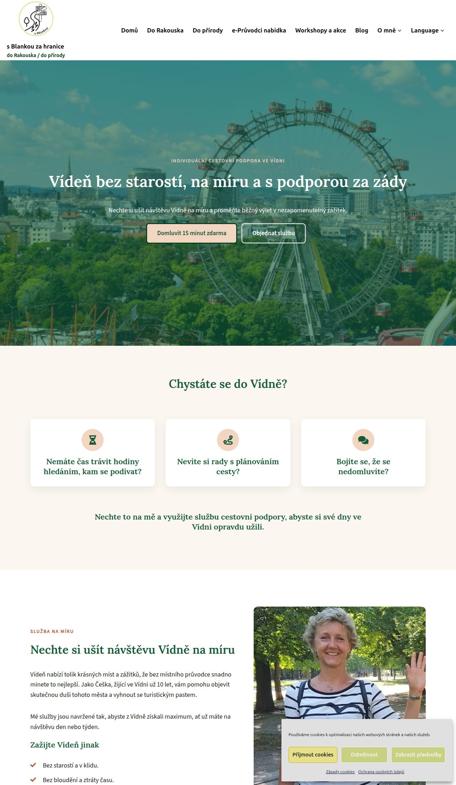
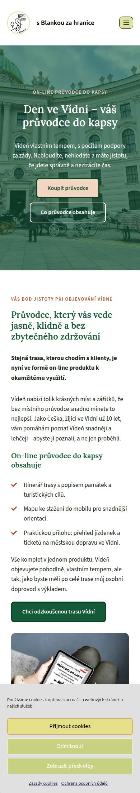
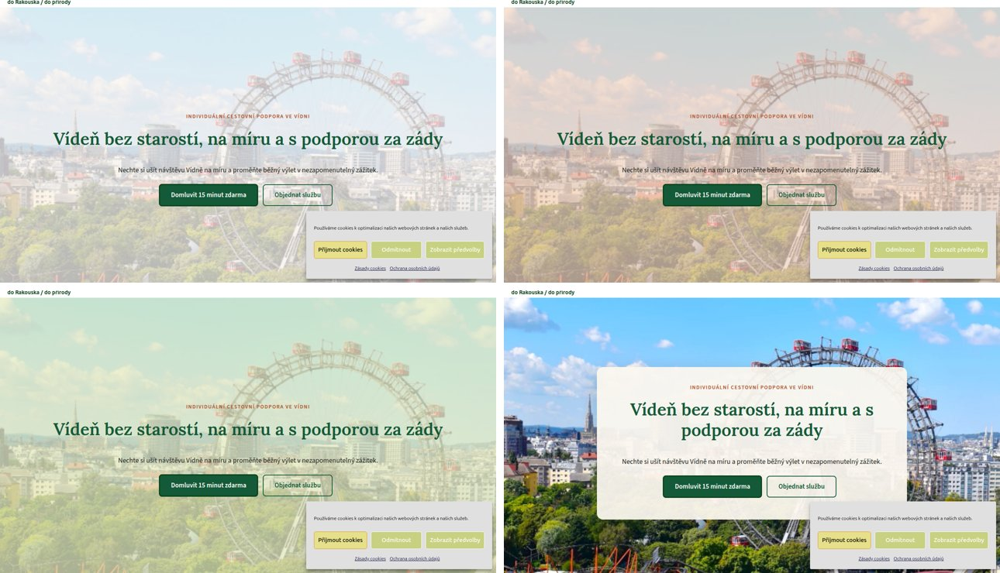
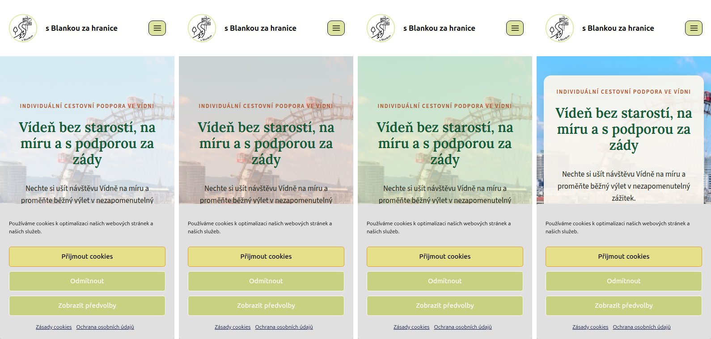
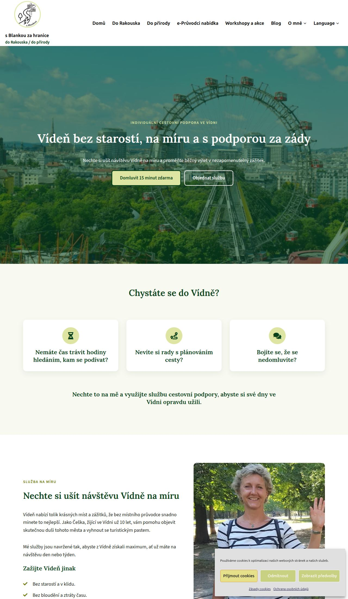
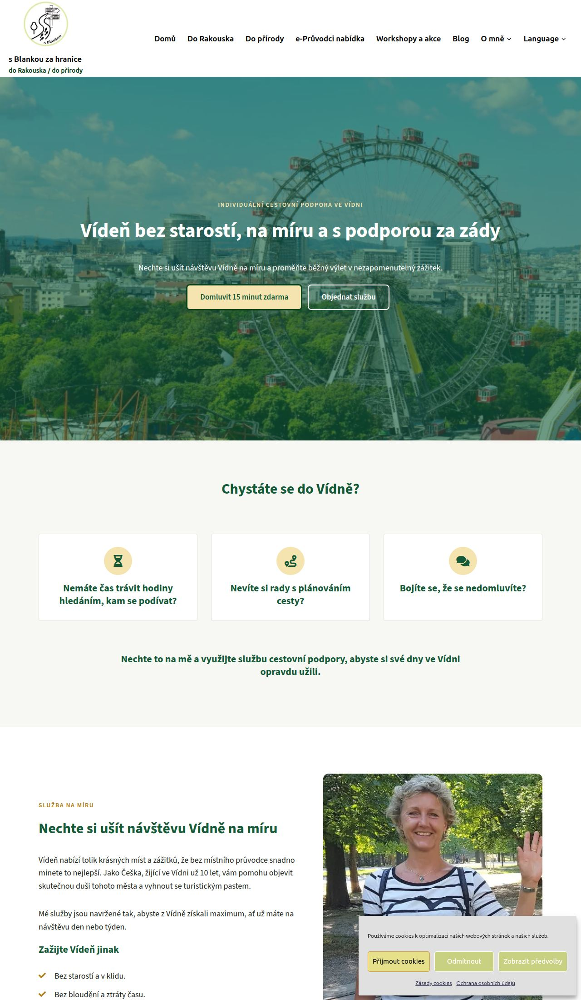
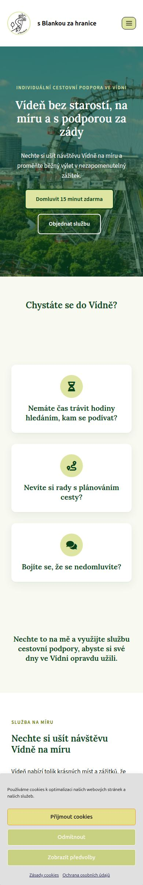
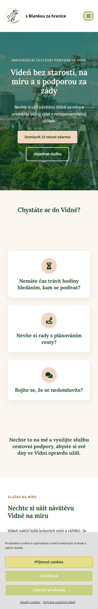
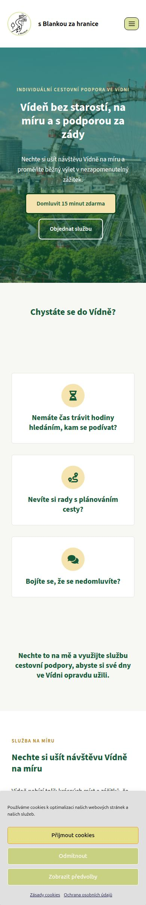

# Co dalšího jde na webu zlepšit – návrhy pro Blanku

*Měřeno 15. 10. 2026. Živý web sblankouzahranice.eu jsem jen četl, všechny úpravy jsou na sandboxu.*

U každého bodu je napsané, **co to přinese**, **kolik to dá práce** a jestli je to **už vyzkoušené na sandboxu**.
Stačí Claudovi napsat třeba *„bod 2 ano, bod 5 ne“*.

---

## ✅ Vybráno (15. 10.): písmo a terakota z varianty B, zelená z varianty C

Blanka vybrala kombinaci: nadpisy písmem Lora a terakotový akcent z varianty B, světlejší zelená **#145A38** z varianty C (blíž dnešní zelené na webu).
Nová paleta je nastavená pro všechny stránky v novém designu:

| Barva | Kód | Kde se použije |
|---|---|---|
| Zelená (hlavní) | `#145A38` | nadpisy, tmavá tlačítka, pruh s výzvou |
| Terakota (akcent) | `#B0532B` | drobné nadtitulky, odrážky, ikonky |
| Světlá terakota | `#F3D6C1` | zvýraznění v nadpisech, světlá tlačítka, kolečka ikon |
| Krémové pozadí | `#FBF6EF` | pozadí sekcí |

| Vídeň – cestovní podpora | Den ve Vídni (mobil) |
|---|---|
|  |  |

Odkazy: [Vídeň – cestovní podpora](https://sandbox.xafour.eu/viden-cestovni-podpora-novy-design/) · [Den ve Vídni](https://sandbox.xafour.eu/den-ve-vidni-novy-design/)

Původní varianty pro srovnání zůstávají níže (stránka varianty B teď vypadá stejně jako vybraná kombinace).

---

## Úvodní fotka bez tmavě zeleného závoje – vyberte si (15. 10.)

Blance se nelíbil tmavě zelený závoj přes úvodní fotku: je moc tmavý a neláká číst dál. Připravil jsem proto 4 světlé varianty. Ve všech je text zelený a tlačítka plná zelená + obrysová.
Varianta „krémová“ je teď nastavená na obou stránkách v novém designu. Až si vyberete, nastaví se vybraná na všech stránkách.

| | Odkaz |
|---|---|
| 1 – krémový závoj (teď nastavený) | [otevřít](https://sandbox.xafour.eu/viden-cestovni-podpora-novy-design/) |
| 2 – broskvový závoj (světlá terakota) | [otevřít](https://sandbox.xafour.eu/viden-cestovni-podpora-uvod-broskev/) |
| 3 – světle olivový závoj (jako lišta cookies a dnešní web) | [otevřít](https://sandbox.xafour.eu/viden-cestovni-podpora-uvod-oliva/) |
| 4 – fotka bez závoje, text v krémové kartě | [otevřít](https://sandbox.xafour.eu/viden-cestovni-podpora-uvod-karta/) |
| (pro srovnání: původní tmavě zelený) | [otevřít](https://sandbox.xafour.eu/viden-cestovni-podpora-uvod-zelena/) |

Počítač (1 krémová, 2 broskvová / 3 olivová, 4 karta):

Mobil (zleva 1, 2, 3, 4):

Průhlednost závoje jde doladit (víc nebo méně fotky).

---

## Varianty vzhledu – vyberte si (původní nabídka)

Stránka „Vídeň – individuální cestovní podpora“ ve třech barevných variantách. Obsah je stejný, liší se jen barvy a písmo nadpisů.

| | A – „Lesní“ (současný návrh) | B – „Teplá“ | C – „Moderní“ |
|---|---|---|---|
| Barvy | tmavě zelená + olivová | tmavě zelená + terakota | svěží zelená + medová |
| Nadpisy | patkové písmo Lora (elegantní, „knižní“) | Lora | bezpatkové Source Sans 3 (čisté, moderní) |
| Karty a fotky | zaoblené, se stínem | zaoblené, se stínem | hranatější, s tenkým rámečkem |
| Odkaz | [otevřít](https://sandbox.xafour.eu/viden-cestovni-podpora-novy-design/) | [otevřít](https://sandbox.xafour.eu/viden-cestovni-podpora-varianta-b/) | [otevřít](https://sandbox.xafour.eu/viden-cestovni-podpora-varianta-c/) |

| A – Lesní | B – Teplá | C – Moderní |
|---|---|---|
|  |  |  |
|  |  |  |

Jde to i kombinovat, třeba barvy B s nadpisy C. Vybraná varianta se pak použije pro všechny stránky.

---

## 1. Rychlost: obrázky ve formátu WebP ✅ *hotovo na sandboxu*

**Problém:** Fotky už byly převedené do úsporného formátu WebP, ale návštěvníci je nedostávali. Cache a CDN si uložily verzi stránky bez WebP a obrázky na pozadí sekcí (úvodní fotky) se nepřeváděly vůbec.
Úvodní obrázek stránky Vídeň – cestovní podpora měl **1,1 MB**, ve WebP má **140 kB**.

**Řešení:** malý doplněk [`wp-content/mu-plugins/sbz-webp.php`](../wp-content/mu-plugins/sbz-webp.php). Kde je k dispozici WebP verze obrázku, pošle se ta. Doplnil jsem i chybějící WebP verze zmenšenin fotek, které vytváří Elementor.

**Výsledek (měření Google Lighthouse, mobil):**

| Stránka | Před | Po |
|---|---|---|
| Úvodní stránka – velikost | 2,5 MB | **0,95 MB** |
| Úvodní stránka – skóre rychlosti | 68 | **84** |
| Úvodní stránka – hlavní obsah zobrazen za | 7,8 s | **3,2 s** |
| Vídeň – cestovní podpora – velikost | 2,3 MB | **1,0 MB** |
| Vídeň – cestovní podpora – hlavní obsah zobrazen za | 13,3 s | **5,2 s** |

Pro srovnání živý web dnes: úvodní stránka 2,7 MB, hlavní obsah za 5,2 s, stránka Vídeň – cestovní podpora 15,1 s.

**Vrácení:** smazat jeden soubor. Velmi staré prohlížeče bez podpory WebP (méně než 1 % návštěv) by obrázky neviděly. Šlo by doplnit záložní řešení.

## 2. Rychlost: přestat načítat zbytečná písma a skripty — *malá práce*

Stránka se začne vykreslovat až po stažení několika souborů, které nepotřebuje:
- písmo **Open Sans** z cizího serveru fonts.bunny.net (zdržení asi 0,8 s), dál písmo **Roboto** a tři sady ikon Font Awesome,
- plugin **Google Language Translator** (styly a skript na každé stránce) – nahradí ho vícejazyčnost, viz bod 6,
- skripty **Elementor Pro** (asi 90 kB, většina nevyužitá) – odpadnou, až po skončení licence přejdou stránky na nový design.

**Přínos:** asi o 1 s rychlejší první zobrazení na mobilu.

## 3. Velké PNG obrázky převést na fotky (JPG) — *malá práce, automaticky*

Některé fotky jsou uložené jako PNG, což je formát pro grafiku. Fotka v něm má několikanásobnou velikost. Příklady:
- `Voucher-na-lesni-mysl.png` – 1,1 MB (stránky Regenerační procházky, Přírodou k sobě),
- `vylet-Heilingenkreuz.png` – 1,1 MB, `Grafika-na-web.png` – 1 MB (Průvodce Vídeň – zahrady a parky),
- `Dojdi-si-pro-zivot.png`, `dekorace-unor-nahled.png` – 0,85 MB.

WebP z bodu 1 tohle z velké části řeší. Zbývá ale **originál**, který se stahuje při kliknutí na fotku a který si bere Google.

## 4. SEO: drobnosti, které pomohou ve vyhledávání — *malá práce*

Kontrola všech 147 stránek ze sitemapy:

| Zjištění | Kolik | Proč to vadí |
|---|---|---|
| Stránky **bez hlavního nadpisu (H1)** | 48 | Google podle H1 pozná, o čem stránka je. **Seznam s návodem: [H1-NADPISY.md](H1-NADPISY.md)** |
| Stránky se **stejným obecným titulkem** jako úvodní stránka | 12 (mj. Do Rakouska, Do přírody, Reference, Regenerační procházky) | Google je od sebe nerozliší. |
| **Obrázky bez popisku (alt)** | 102 obrázků na 33 stránkách | Google obrázky „nečte“, popisek mu řekne, co na nich je. Pomáhá to i nevidomým. |
| Stránky **bez popisu pro Google** | 10 (mj. Nabídka pro kolektivy, Vídeň adventní, Obchodní podmínky) | Google si pak vybere náhodný kus textu. |
| Stránky **Test** a **Ukázková stránka** jsou v Googlu | 2 | Stránka Test by ve vyhledávání být neměla. Ochrana osobních údajů má adresu `/sample-page/`, šlo by ji změnit na `/ochrana-osobnich-udaju/` s přesměrováním. |
| Titulek úvodní stránky | „s Blankou za hranice - do Rakouska / do přírody“ | Chybí v něm, co nabízíte. Návrh je níže pod tabulkou. |
| Odkazy na `www.` a `http://` verzi webu | na 6 stránkách | Každý takový odkaz prochází přesměrováním navíc. |
| Nefunkční odkaz | `http://www.test.sblankouzahranice.eu/vylety` | Vede na neexistující adresu. |

### Doporučený titulek a popis úvodní stránky

Google ukáže asi 60 znaků titulku, proto je na začátku to, co lidé hledají.

- **SEO titulek (doporučuji):** `Vídeň a Rakousko s českou průvodkyní | s Blankou za hranice` (58 znaků)
- Kratší varianta: `Vídeň s českou průvodkyní | s Blankou za hranice` (48 znaků)
- **Popis pro Google (meta popis):** `Žiju ve Vídni přes 10 let a pomůžu vám ji poznat bez stresu: cestovní podpora na míru, e-průvodci do kapsy, výlety a pobyty v Rakousku i v přírodě.` (148 znaků)

Kam to napsat: Stránky → Domů → Upravit (WordPress, ne Elementor) → dole box **Yoast SEO** → **SEO titulek** a **Meta popis**.

### Jak skrýt stránku Test z Googlu (můžete hned i na živém webu)

1. Stránky → **Test** → **Upravit** (WordPress, ne Elementor).
2. Dole v boxu **Yoast SEO** klikněte na **Pokročilé**.
3. „Povolit vyhledávačům zobrazit tuto stránku ve výsledcích vyhledávání?“ → **Ne**.
4. **Aktualizovat.** Google ji při další návštěvě z výsledků vyřadí, obvykle do pár týdnů.

Stejně skrýt: Mustr nové stránky, poděkovací stránky a kopii „jak-se-zije-za-hranici-duplicate“. Na sandboxu jsou Test a Mustr skryté už teď. Až budeme přenášet změny na živý web, udělám to tam i za vás.

## 5. Cache na živém webu — *hotovo na sandboxu, čeká na přenos*

Živý web dnes odpovídá průměrně za **2,4 s** (měřeno na 147 stránkách). Sandbox s cache odpovídá za 0,07–0,3 s.
Na živý web se přenese spolu s redesignem.

## 6. Vícejazyčnost (DE / SK) — *čeká na vaše rozhodnutí*

Současný Google Language Translator překládá strojově za chodu. Google takové překlady nevidí a kvalita je slabá.
- **TranslatePress** (doporučuji): překládá se přímo na stránce, kterou člověk vidí. Strojový návrh se dá ručně opravit. Každý jazyk má vlastní adresu (`/de/…`), takže ho najde i Google. Zdarma 1 další jazyk, placená verze asi 99 € za rok.
- **Polylang**: zdarma, ale každá stránka se v Elementoru dělá znovu jako samostatná kopie.

Navrhuji začít jen stránkami služeb v němčině, ne celým blogem.

## 7. Instagram feed — *čeká na rozhodnutí*

Plugin Smash Balloon načítá fotky z Instagramu a stránku tím zpomaluje (na kterých stránkách a o kolik, změřím podle potřeby). Alternativa je statický odkaz „Sledujte mě na Instagramu“ s několika vybranými fotkami. Rychlejší a bez propojení účtu.

## 8. Hlavička a patička v novém designu — *střední práce*

Přijde na řadu, až vyberete variantu vzhledu. Teď mají hlavička a patička ještě původní vzhled.

## 9. Formuláře bez Elementoru Pro — *střední práce, do března 2027*

Licence Elementor Pro končí 18. 3. 2027. Kontaktní formuláře je potřeba převést (WPForms je nainstalovaný, nejdřív otestovat povinná pole na sandboxu) a pohyblivé nadpisy nahradit novým zvýrazněním. To už je hotové na stránkách v novém designu.

---

### Jak se tyto návrhy dělaly

Všechno je zaznamenané ve větvi `navrhy/optimalizace`:
- kontrola webu: [`tools/audit_web.py`](../tools/audit_web.py)
- WebP doplněk: [`wp-content/mu-plugins/sbz-webp.php`](../wp-content/mu-plugins/sbz-webp.php)
- varianty barev: konec souboru [`design/sbz.css`](../design/sbz.css)
