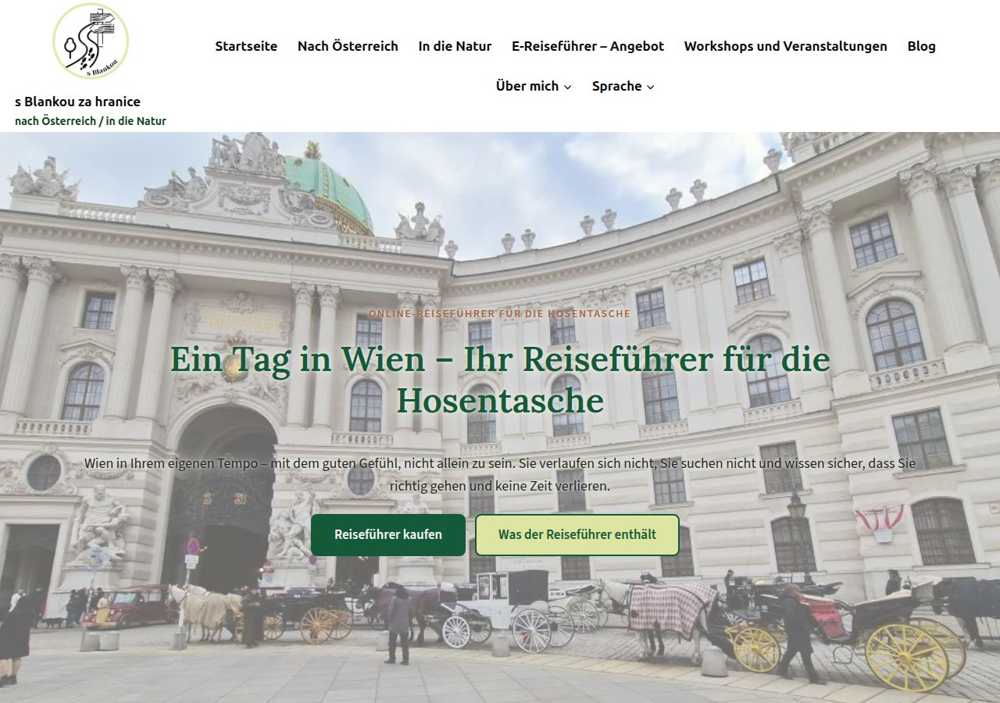
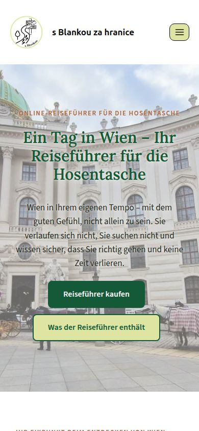

# Němčina na webu: ukázka stránky Den ve Vídni

**Ukázka:** https://sandbox.xafour.eu/de/den-ve-vidni-novy-design/
Česká verze zůstává na stejné adrese bez `/de/`: https://sandbox.xafour.eu/den-ve-vidni-novy-design/

| Počítač | Mobil |
|---|---|
|  |  |

## Jak to funguje

- Na sandboxu je nainstalovaný plugin **TranslatePress** (bezplatná verze). Ta umí **jeden další jazyk zdarma**, tedy němčinu.
- Německá stránka má vlastní adresu `/de/…`. Google ji proto najde a ukáže lidem, kteří hledají německy.
  - Dnešní Google Language Translator překládá až v prohlížeči návštěvníka, takže Google ten překlad vůbec nevidí.
- **Překlady jsem napsal já (Claude), ne strojový překladač.** Vy nemusíte nic dělat ručně.
  - Automatický překlad přímo v pluginu by potřeboval placený klíč ke Google Translate nebo DeepL a výsledek by se stejně musel kontrolovat.
- Na stránce jsou přeložené všechny texty, menu, patička i lišta cookies. Použil jsem rakouskou němčinu, např. „Öffis“ a „Jänner“, a vykání.
- **Dodržel jsem omezení:** nikde neříkám, že jste průvodkyně. Píšu „Reiseunterstützung“ a „persönliche Begleitung“. „Online-Reiseführer“ je jen název PDF produktu.
- **Když změníte český text,** stačí přeložit jen změněnou větu. Ostatní překlady zůstanou. Napíšete Claudovi „přelož změny na stránce X“.

## Co bezplatná verze neumí

- **Titulek stránky a popis pro Google** (to, co se ukazuje ve výsledcích vyhledávání), **popisky obrázků** a **německou adresu stránky**, např. `/de/ein-tag-in-wien/`.
  - V ukázce proto zůstává v záložce prohlížeče český titulek a adresa je `/de/den-ve-vidni-novy-design/`.
  - Tohle umí až placená verze (rozšíření SEO Pack) za **asi 99 € ročně**. Aktuální cenu je potřeba ověřit na translatepress.com.
- **Objednávkový formulář SimpleShop** se načítá ze SimpleShopu, takže zůstane česky. Německou verzi formuláře by bylo potřeba založit u SimpleShopu.

## Co to znamená pro rychlost

- TranslatePress posílá návštěvníkovi rovnou hotovou německou stránku. Žádný překlad za chodu v prohlížeči.
- Když na jeho místo odebereme **Google Language Translator**, každá stránka přestane načítat jeho styly a skript.
- Na sandboxu jsem Google Language Translator zatím nechal zapnutý. Rozhodneme až podle vás.

## Doporučení

Začít s **němčinou jen u stránek služeb a produktů**, jak navrhujete.
Až se rozhodnete, přeložím je stejným způsobem jako tuto ukázku.
Placenou verzi se SEO Packem bych zvážil až ve chvíli, kdy budete chtít německé stránky aktivně dostat do Googlu.
