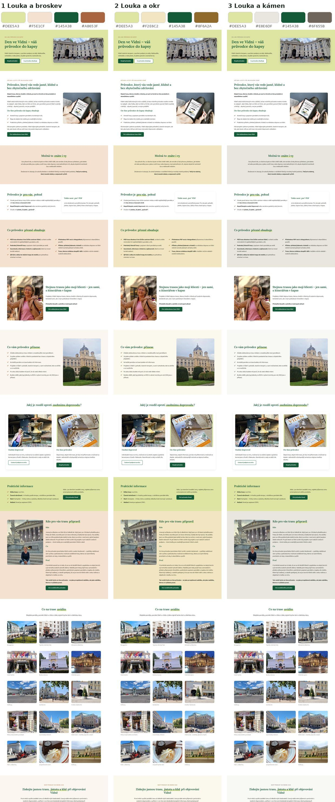
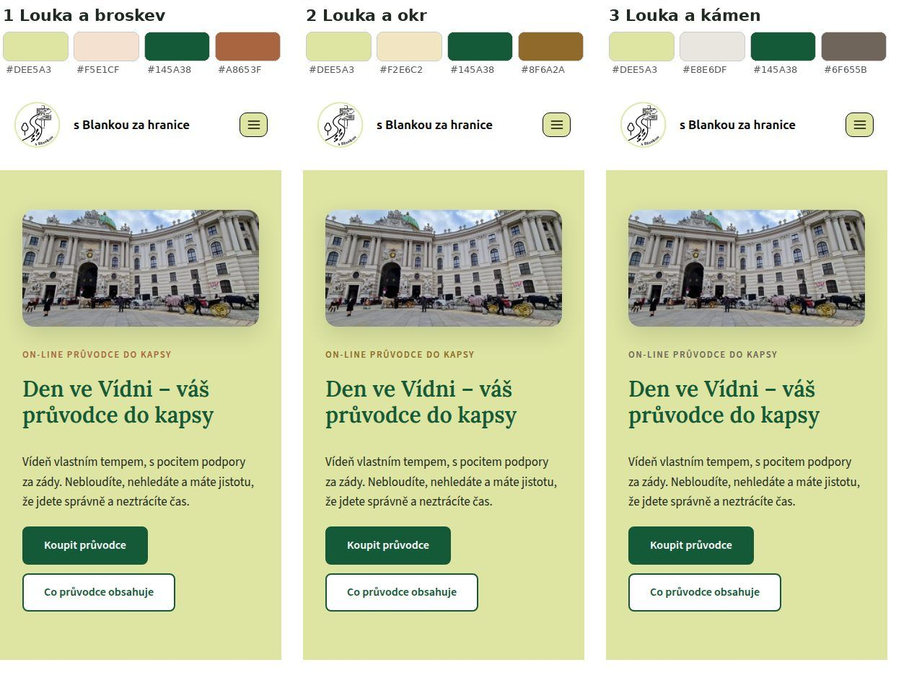

# Nové barvy: 3 palety k výběru (15. 10.)

Podklady: vaše připomínky ke stránce Den ve Vídni. Tmavé barvy se nemají používat na velké plochy, tlačítka mají mít
všude stejnou barvu a úvodní fotka má být víc vidět.

## Co platí pro všechny tři palety

- **Dvě světlé základní barvy na pozadí sekcí:**
  - **světle olivová #DEE5A3**, stejná jako rámečky vašich fotek z Canvy (změřeno přímo z fotky),
  - **doplňková světlá barva**, v každé paletě jiná.
- **Dvě tmavé barvy jen na zvýraznění:**
  - **tmavě zelená #145A38** na tlačítka a nadpisy,
  - **doplňková tmavá barva** jen na drobnosti: nadtitulky a odškrtávátka v seznamech.
- **Žádná velká tmavá plocha.** Sytě zelený pruh „Praktické informace“ je teď světle olivový.
- **Tlačítka (upraveno podle Blanky 15. 10. odpoledne):**
  - hlavní tlačítko je tmavě zelené a po najetí myší zesvětlá do světle olivové,
  - vedlejší tlačítko (např. Osobní doprovod) je světle olivové a po najetí ztmavne do tmavě zelené,
  - terakota, modrá ani jiné barvy už na tlačítkách nejsou.
- **Úvodní fotka přes celou šířku** se slabým krémovým závojem (dřív zakrýval 74 % fotky, teď 42 %).
  Kolem písmen je jemná světlá záře, aby text zůstal čitelný.
- **Žádné podbarvené slovo v nadpisech.** Dřív to nahrazovalo animovaný text z Elementor Pro, teď jsou nadpisy čisté.

## Palety

| | Světlá doplňková | Tmavá doplňková | Odkaz na ukázku |
|---|---|---|---|
| **1 Louka a broskev** | broskvová **#F5E1CF** (podobná dnešnímu světlému tlačítku) | zjemněná terakota **#A8653F** | https://sandbox.xafour.eu/den-ve-vidni-paleta-1-broskev/ |
| **2 Louka a okr** | písková / světlý okr **#F2E6C2** | tmavý okr **#8F6A2A** | https://sandbox.xafour.eu/den-ve-vidni-paleta-2-okr/ |
| **3 Louka a kámen** | světlá šedá jako kámen **#E8E6DF** | teplá šedohnědá **#6F655B** | https://sandbox.xafour.eu/den-ve-vidni-paleta-3-kamen/ |

Každá ukázka má barvy pevně nastavené, takže se nezmění ani po vašem výběru a dají se kdykoli znovu porovnat.
Hlavní stránka https://sandbox.xafour.eu/den-ve-vidni-novy-design/ je zatím v paletě 1.

## Ostrost úvodní fotky

Fotka `Zahlavi-new.jpg` má šířku jen 1200 bodů, takže ji prohlížeč přes celou obrazovku zvětšuje.
Na velkém monitoru proto může být lehce měkká. Stejná fotka ve větším rozlišení (aspoň 2400 bodů, stačí originál z telefonu) by byla ostrá.

## Formulář SimpleShop: barvy se nastavují u SimpleShopu

Objednávkový formulář se načítá přímo ze SimpleShopu. Na webu ho přebarvit nejde.

1. Přihlaste se na simpleshop.cz.
2. Otevřete **Nastavení → Vzhled formulářů** (nebo vzhled u konkrétního produktu).
3. Barvu tlačítka nastavte na tmavě zelenou **#145A38**.

Po výběru palety vám pošlu přesné kódy barev i pro ostatní prvky.

## Další soubory

- Co se změnilo v textech stránky Den ve Vídni: [TEXTY-DEN-VE-VIDNI.md](TEXTY-DEN-VE-VIDNI.md)
